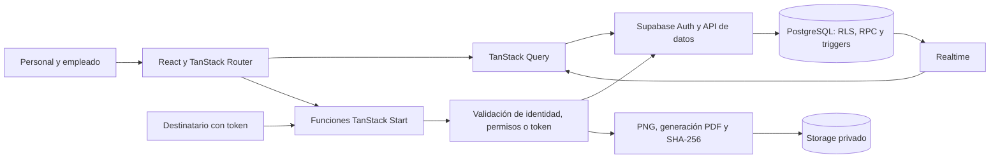
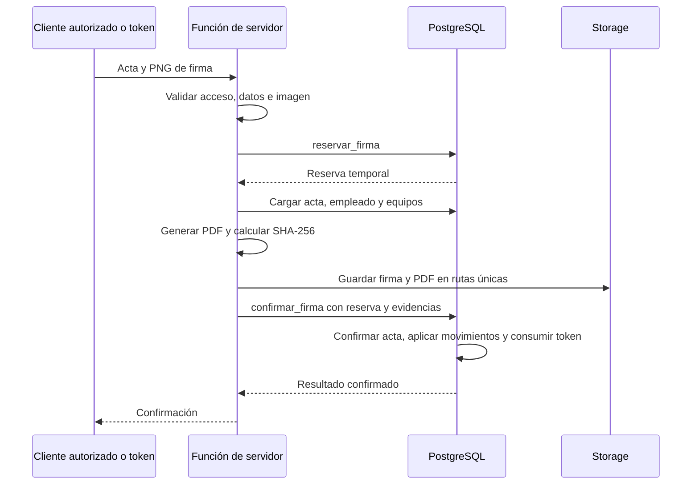

# Arquitectura de la aplicación

[Índice de documentación](README.md) · Revisión: 24 de noviembre de 2026.

## Componentes y responsabilidades

La aplicación combina una interfaz React, funciones de servidor de TanStack Start y servicios Supabase. Las lecturas y escrituras ordinarias del navegador utilizan el cliente público autenticado, sujeto a RLS; las operaciones privilegiadas pasan por funciones de servidor. PostgreSQL aplica las reglas de negocio incluso si una petición no procede de la interfaz.

El middleware de red controla las peticiones al servidor de aplicación. Las llamadas directas del navegador a Supabase tienen además su propio control de identidad/RLS; en la instalación local el gateway solo escucha en loopback.

## Tecnologías del repositorio

| Capa                    | Implementación                                                            |
| ----------------------- | ------------------------------------------------------------------------- |
| Interfaz                | React 19, TypeScript, Tailwind CSS 4, Radix UI y componentes propios      |
| Navegación y servidor   | TanStack Router/Start, Vite y salida de servidor Nitro                    |
| Estado remoto           | TanStack Query y suscripciones Supabase Realtime                          |
| Identidad y datos       | Supabase Auth, PostgreSQL, RLS y funciones SQL                            |
| Documentos              | `pdf-lib` en servidor para actas; `jspdf`/`jspdf-autotable` para reportes |
| Importación/exportación | SheetJS `xlsx`, Papa Parse y JSZip                                        |
| Pruebas                 | Vitest, PGlite y pruebas de scripts con Node                              |
| Operación local         | Bun para dependencias/build, Node para scripts/servidor y Docker Compose  |

Las versiones y restricciones exactas están en [package.json](../package.json) y `bun.lock`. No usar esta tabla como sustituto del lockfile.

## Estructura del código

| Ruta                                  | Responsabilidad                                                          |
| ------------------------------------- | ------------------------------------------------------------------------ |
| `src/routes/`                         | Páginas, formularios y rutas públicas/protegidas                         |
| `src/routes/_authenticated/route.tsx` | Control de acceso, navegación, sesión e invalidación de consultas        |
| `src/components/`                     | Actas, tablas, firma, importación, proveedores, pedidos y componentes UI |
| `src/lib/*.functions.ts`              | Funciones de servidor invocables por TanStack Start                      |
| `src/lib/*.server.ts`                 | Implementación exclusiva de servidor, seguridad, PDF y configuración     |
| `src/integrations/supabase/`          | Clientes, middleware de autenticación y tipos de base de datos           |
| `src/start.ts`                        | Configuración del servidor y middleware de peticiones                    |
| `src/routeTree.gen.ts`                | Árbol de rutas generado; no editar manualmente                           |
| `supabase/migrations/`                | Esquema, permisos, triggers y evolución de reglas                        |
| `scripts/` y `deploy/`                | Instalación, migraciones, arranque, respaldo y configuración Docker      |
| `tests/unit/`, `tests/rls/`           | Pruebas de funciones y de base de datos                                  |

## Rutas y navegación

| Rutas                                                                | Acceso                                                                     |
| -------------------------------------------------------------------- | -------------------------------------------------------------------------- |
| `/`, `/recuperar`, `/restablecer`                                    | Entrada y recuperación de cuenta                                           |
| `/firmar/$token`                                                     | Firma por token, sin sesión de usuario; red y token se validan en servidor |
| `/panel`, `/equipos`, `/equipos/$id`, `/empleados`, `/empleados/$id` | Personal activo                                                            |
| `/actas`, `/actas/nueva`, `/actas/$id`                               | Personal según permisos de consulta, creación o firma                      |
| `/reabastecimiento`, `/proveedores`, `/carga-masiva`                 | Personal con permiso del módulo                                            |
| `/estadisticas`, `/reportes`, `/catalogos`                           | Personal con permiso del módulo                                            |
| `/usuarios`, `/auditoria`                                            | Administrador                                                              |
| `/mi-portal`                                                         | Empleado                                                                   |
| `/ajustes`                                                           | Cuenta activa con rol válido                                               |

`$id` y `$token` representan parámetros de ruta. `_authenticated` es un grupo sin segmento visible en la URL. El grupo protegido deshabilita SSR porque su sesión reside en el navegador. Ver [route-access.ts](../src/lib/route-access.ts) para las condiciones exactas.

## Autenticación y consultas

El navegador conserva la sesión mediante el cliente Supabase. `loadVerifiedMe()` utiliza la sesión local para detectar cambios de cuenta y `getUser()` para verificar identidad, seguido de perfil, roles y permisos. La caché de `me` dura 30 segundos. La autorización efectiva permanece en RLS y en las funciones de servidor.

Las funciones protegidas reciben el Bearer mediante el middleware correspondiente. Los módulos con acceso administrativo no deben importarse en el cliente. La configuración de Vite/TanStack incluye protección de importaciones; la clave `SUPABASE_SERVICE_ROLE_KEY` nunca forma parte de la configuración pública `VITE_`.

Los listados principales usan rangos y conteos en servidor. La invalidación de Realtime agrupa eventos durante 300 ms y vuelve a consultar al reconectar. Los fallos temporales pueden conservar el último resultado visible; los errores de autorización siguen bloqueando el acceso. Esto no proporciona edición sin conexión.

El service worker solo precarga iconos, favicon y manifiesto. No almacena el inventario ni implementa una cola de cambios offline.

## Flujo de firma

La transacción SQL confirma estado y movimientos; la escritura de archivos ocurre en otro servicio. Por ello el servidor usa reservas, rutas únicas por intento y lógica de recuperación/limpieza cuando hay errores. No se debe presentar este flujo como una transacción única que abarque PostgreSQL y Storage. Si se pierde la respuesta de confirmación, se consulta el estado antes de intentar eliminar archivos o repetir la operación.

`firmas.functions.ts` expone `crearEnlaceFirma`, `obtenerActaPorToken`, `firmarConToken`, `firmarPresencial`, `firmarComoEmpleado` y `urlArchivo`. `firmas.server.ts` centraliza la carga del acta, auditoría, PDF y ejecución de firma. No existe en el repositorio un contrato REST externo versionado/OpenAPI para estas funciones: sus entradas y validadores son el contrato de la aplicación.

## Decisiones que deben conservarse

- Los cambios de estado, paz y salvo, series, anulación y recepción se validan en PostgreSQL.
- La firma técnica se copia al acta para evitar que un cambio posterior del perfil altere su evidencia.
- El historial de equipos se produce mediante triggers y contexto de la operación, evitando duplicarlo desde la interfaz.
- Los pedidos y actas compuestos se crean mediante RPC; no reconstruirlos como varias escrituras independientes del cliente.
- Las cuentas y datos de diferentes ámbitos se filtran por propietario o por vínculo del empleado.
- Las migraciones son acumulativas y se controlan por checksum.

Estas decisiones se complementan con [AGENTS.md](../AGENTS.md), [modelo de datos](modelo-de-datos.md) y [roles y seguridad](roles-y-seguridad.md).
