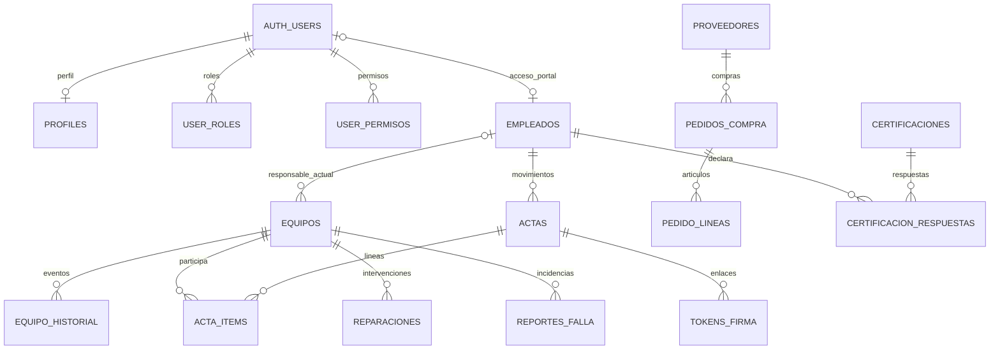

# Modelo de datos y reglas de negocio

[Índice de documentación](README.md) · Revisión: 24 de noviembre de 2026.

## Alcance del modelo

PostgreSQL es la fuente de verdad para identidad de negocio, inventario, movimientos y auditoría. Este documento describe las entidades y campos relevantes; las definiciones completas, valores predeterminados, grants, índices y políticas están en las [migraciones](../supabase/migrations/). El esquema vigente resulta de aplicar **todas** en orden, no solo el archivo consolidado inicial.

Los identificadores de entidades son generalmente UUID. Fechas de negocio usan `date`; los eventos usan `timestamptz`. La presentación de fechas utiliza `America/Bogota`. `owner_id` delimita el ámbito de datos y no debe aceptarse libremente desde el cliente sin validación.

## Relaciones principales

El diagrama resume asociaciones centrales; no muestra todas las relaciones con catálogos, actores, proveedores y reservas. Un acta en construcción puede no tener líneas todavía; la RPC de creación valida el conjunto antes de confirmar la transacción.

## Diccionario funcional

| Entidad                        | Campos o referencias relevantes                                                              | Finalidad                                                                   |
| ------------------------------ | -------------------------------------------------------------------------------------------- | --------------------------------------------------------------------------- |
| `auth.users`                   | `id`, correo, metadatos de aplicación                                                        | Identidad administrada por Supabase Auth                                    |
| `profiles`                     | `id`, `nombre`, `activo`, `firma_path`                                                       | Perfil y firma técnica del usuario                                          |
| `user_roles`                   | `user_id`, `role`, `owner_id`                                                                | Rol y ámbito del personal                                                   |
| `user_permisos`                | `user_id`, `permiso`                                                                         | Permisos por acción; se complementan con metadatos controlados por servidor |
| `catalogo_items`               | `tipo`, `nombre`, `activo`, `owner_id`                                                       | Marcas, tipos de equipo, sedes, áreas y empresas                            |
| `empleados`                    | `nombre`, `identificacion`, `identificacion_normalizada`, `user_id`, `activo`, `owner_id`    | Persona responsable y vínculo opcional con Auth                             |
| `proveedores`                  | Datos de identificación/contacto y propietario                                               | Directorio de proveedores                                                   |
| `articulo_proveedores`         | Proveedor y tipo de artículo                                                                 | Artículos y referencias comerciales por proveedor                           |
| `alertas_stock_config`         | `tipo_id`, `stock_minimo`, `activa`, `owner_id`                                              | Umbrales de existencias                                                     |
| `equipos`                      | `tipo_id`, `serie`, `activo_fijo`, `estado`, `empleado_id`, `owner_id`                       | Inventario actual y responsable                                             |
| `equipo_historial`             | `equipo_id`, `evento`, `detalle`, `acta_id`, `user_id`, `created_at`                         | Línea de tiempo de movimientos                                              |
| `reparaciones`                 | `equipo_id`, `proveedor_id`, `inicio`, `fin`, `owner_id`                                     | Intervenciones sobre equipos                                                |
| `actas`                        | `numero`, `tipo`, `estado`, `empleado_id`, `tecnico_id`, rutas, firma y anulación            | Cabecera del movimiento y evidencia documental                              |
| `acta_items`                   | `acta_id`, `equipo_id`, `direccion`, `estado_destino`, `estado_fisico`, `accesorios`, `nota` | Equipos y condiciones de cada acta                                          |
| `tokens_firma`                 | `acta_id`, `token`, `expires_at`, `used_at`, `created_by`                                    | Acceso temporal a firma; uso exclusivo del servidor                         |
| `pedidos_compra`               | `numero`, `proveedor_id`, `estado`, fechas, `owner_id`                                       | Cabecera de pedido                                                          |
| `pedido_lineas`                | `pedido_id`, `tipo_id`, `cantidad`, `recibida`, `precio_estimado`                            | Cantidades solicitadas y recibidas                                          |
| `solicitudes_reabastecimiento` | Tipo, cantidad y estado                                                                      | Histórico; el flujo vigente usa pedidos                                     |
| `reportes_falla`               | `equipo_id`, empleado, descripción, estado y respuesta                                       | Incidencias declaradas por empleados                                        |
| `certificaciones`              | Campaña y condiciones de participación                                                       | Solicitud de confirmación de tenencia                                       |
| `certificacion_respuestas`     | Certificación, empleado y declaración                                                        | Respuesta de tenencia y faltantes                                           |
| `auditoria`                    | `user_id`, `tabla`, `accion`, `registro_id`, `antes`, `despues`, `detalle`                   | Evidencia de operaciones; no permite modificación o eliminación             |

En `equipos` también se conservan marca, sede, modelo, código interno, nombre de equipo, sistema operativo, compra, factura, garantía, reparación, `prestamo_hasta` y `baja_documento_path`.

En `actas` se conserva `es_prestamo`, vencimiento, equipo reparado relacionado, copia de firma técnica, `firmado_at`, `firma_ip`, `firma_user_agent`, `firma_medio`, `firma_path`, `pdf_path`, `pdf_hash` y datos de anulación. El número de acta es una identidad numérica única, distinta del UUID.

### Esquemas internos

`app_private.equipo_reservas`, `app_private.firma_reservas` y `app_private.pin_reservas` coordinan equipos comprometidos en actas, confirmaciones concurrentes e intentos de PIN. No forman parte de una API para el navegador. `finesa_local.migrations` registra las migraciones aplicadas por el script local.

## Estados y transiciones

| Concepto              | Valores                                                                 |
| --------------------- | ----------------------------------------------------------------------- |
| Rol                   | `admin`, `auxiliar`, `empleado`                                         |
| Equipo                | `disponible`, `asignado`, `en_alistamiento`, `en_reparacion`, `de_baja` |
| Tipo de acta          | `entrega`, `devolucion`, `cambio`                                       |
| Estado de acta        | `pendiente`, `firmada`, `anulada`                                       |
| Dirección de línea    | `entrega`, `devolucion`                                                 |
| Destino de devolución | `disponible`, `en_alistamiento`, `en_reparacion`                        |
| Pedido                | `borrador`, `pedido`, `parcial`, `recibido`, `cancelado`                |

Al firmar una entrega se asigna el empleado; al firmar una devolución se limpia el responsable y se aplica el destino de cada línea. Un cambio combina ambos sentidos. El préstamo usa las mismas transiciones y agrega vencimiento.

La anulación marca el documento y consume sus enlaces, pero no realiza una transición inversa del inventario. La reparación puede conservar el responsable; `finalizar_reparacion` permite devolver al empleado vinculado o liberar el equipo. La baja es definitiva en el flujo normal.

## Reglas de integridad

- La identificación normalizada elimina caracteres no alfanuméricos y pasa a mayúsculas; no puede quedar vacía ni repetirse globalmente.
- La serie de equipo es única. El activo fijo tiene unicidad cuando no es nulo. La edición ordinaria de serie está bloqueada; su corrección exige administrador y motivo.
- Las referencias de empleado, catálogo, equipo y proveedor se comprueban respecto del ecosistema.
- No se asigna un equipo con una actualización libre de `estado`: se usan los flujos autorizados. La carga inicial y la finalización de reparación tienen reglas específicas.
- Las reservas evitan que un equipo participe simultáneamente en actas pendientes incompatibles.
- El retiro del empleado se bloquea si incumple paz y salvo.
- La recepción valida cantidades, seriales, placas y el estado del pedido, y actualiza inventario y recepción de manera atómica por llamada.
- La creación de acta/pedido y las operaciones de firma validan permisos y condiciones en base de datos; no confiar únicamente en filtros del formulario.

## RPC principales

| Función o grupo                                                                                                                  | Efecto y consumidor                                                     |
| -------------------------------------------------------------------------------------------------------------------------------- | ----------------------------------------------------------------------- |
| `my_owner_id`, `my_empleado_id`, `has_role`, `has_permiso`, `usuario_habilitado`                                                 | Resuelven alcance/autorización en políticas y funciones                 |
| `crear_acta`                                                                                                                     | Crea cabecera y líneas del movimiento desde el personal autorizado      |
| `crear_prestamo_contingencia`                                                                                                    | Registra reparación y acta de préstamo con sus validaciones             |
| `reservar_firma`, `confirmar_firma`, `cancelar_firma`                                                                            | Protocolo de confirmación utilizado por el servidor                     |
| `anular_acta`                                                                                                                    | Anulación administrativa con motivo, invalidación de tokens e historial |
| `cambiar_estado_equipo`, `finalizar_reparacion`, `marcar_alistado`                                                               | Transiciones controladas e historial                                    |
| `corregir_serie`                                                                                                                 | Corrección administrativa auditada                                      |
| `asignar_carga_inicial`                                                                                                          | Asignaciones iniciales del importador                                   |
| `crear_pedido`, `recibir_pedido_linea`                                                                                           | Compra y recepción transaccional                                        |
| `reportar_falla`, `atender_falla`, `certificar_equipos`                                                                          | Operaciones de portal y atención                                        |
| `reservar_intento_pin`, `finalizar_intento_pin`                                                                                  | Serialización de intentos desde servidor                                |
| `reemplazar_permisos_usuario`                                                                                                    | Sustitución consistente de permisos mediante servidor                   |
| `panel_conteos`, `panel_conteos_actas`, `stock_bajo`, `resumen_proveedores`, `estadisticas_inventario`, `estadisticas_avanzadas` | Consultas agregadas autorizadas                                         |

Esta tabla no concede acceso a las RPC ni sustituye sus firmas SQL. Para desarrollar un consumidor, revisar los parámetros, grants y la última definición de la función en las migraciones.

## Almacenamiento

Los buckets `actas`, `facturas` y `firmas` se crean privados. El código vigente guarda las firmas técnicas, copias para actas, firmas de empleados y PDF del flujo de firma en **`actas`**; no debe deducirse el destino por el nombre del bucket `firmas`. Los soportes de compra y baja usan `facturas`.

Los intentos de firma emplean rutas únicas con identificadores de acta y reserva. La base almacena las rutas y el hash del PDF; los bytes residen en Storage. Un respaldo completo requiere tanto PostgreSQL —incluidos Auth y metadatos de Storage— como los archivos y las claves originales.

## Historial de migraciones

| Archivo                                                 | Aporte                                                                         |
| ------------------------------------------------------- | ------------------------------------------------------------------------------ |
| `20261021000000_esquema_consolidado.sql`                | Entidades, roles, RLS, triggers y funciones iniciales                          |
| `20261021170000_carga_masiva_ecosistema.sql`            | Ajustes de asignación inicial por ecosistema                                   |
| `20261022120000_mejoras_actas_baja_storage.sql`         | Hash de PDF, soporte de baja, políticas de archivos y conteos de actas         |
| `20261023000000_storage_buckets_actas_firmas.sql`       | Creación de buckets privados requeridos                                        |
| `20261111174151_seguridad_integridad_transaccional.sql` | Identidad normalizada, cuentas activas, reservas y operaciones transaccionales |
| `20261123011416_optimizar_consultas_rls.sql`            | Optimización de evaluaciones RLS y consultas agregadas                         |

La migración de integridad comprueba previamente identificaciones ambiguas, cambios sin dirección, reservas duplicadas, fallas abiertas duplicadas y cantidades inválidas. Si falla, se debe corregir la información de forma explícita conservando la trazabilidad.

**Fuentes:** [esquema y evolución SQL](../supabase/migrations/), [tipos del cliente](../src/integrations/supabase/types.ts), [constantes](../src/lib/constantes.ts), [firma en servidor](../src/lib/firmas.server.ts) y [firma técnica](../src/lib/ajustes.functions.ts).
